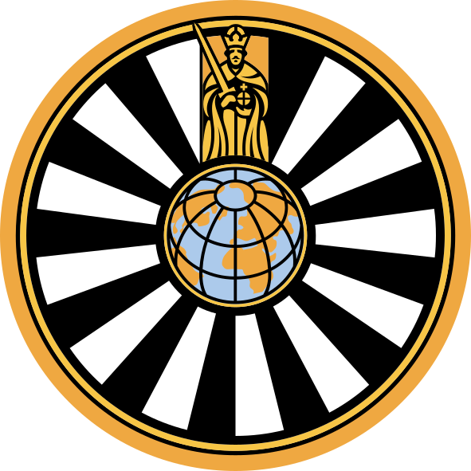

# riverside-bengal — ASPA AGM 2026 LED Wall

A full-screen, continuously animated, hand-illustrated Bangladesh panorama
built as a live event backdrop for the **3rd Annual General Meeting of
Round Table Bangladesh (ASPA AGM 2026)** — designed for a 2:1 LED wall
at 1920 × 960.



## What it is

A single-page, zero-dependency *motion-graphics package* implemented as a
real-time web experience:

- **Background — "Riverside Bengal" mural.** One artist's continuous
  Canvas2D landscape: braided river with drifting currents, a Padma-style
  cable-stayed bridge with gold harp cables, a village with thatched
  homes (animated chulha smoke), mango/banyan trees, coconut palms,
  banana plants, paddy terraces, arching lotus blooms, a painted cycle
  rickshaw, two egrets crossing the sky. On launch the mural *draws
  itself in*, stroke by stroke, over ~15 s. Ink alphas, selective
  hatching and fixed per-stroke tremor give it a genuine hand-sketch
  character. The centre stays clear for event content.
- **Foreground — five-stage identity sequence** on an independent
  timeline controller (8 s headline · 6 s RTI · 8 s trio · 10 s five
  clubs · 8 s finale, 1 s crossfades, endless seamless loop). Background
  never resets between scenes.

No WebGL, no frameworks, no build step. Fonts, logos and code are plain
files; palette derives from the club rondels (ink green, ivory, gold,
red, teal).

## Run (presentation mode)

Open `index.html` in any Chromium browser → press `F` for fullscreen.
It autoplays and loops forever; no interaction needed.

For a proper stage preview serve the folder:

```
python -m http.server 8080
# → http://localhost:8080
```

### Test locks

| URL | Behaviour |
|---|---|
| `?bt=14` | freezes the mural + sketch clock at 14 s |
| `?ft=31` | pins the foreground to the "five logos" scene (end states) |
| `?loop=0` | hold on the finale instead of looping |
| `&debug` combo | combine both locks for deterministic stills |

## Files

| Path | Role |
|---|---|
| `index.html` | stage, foreground scenes, timeline controller |
| `doodle-bg.js` | mural background engine (`MuralBG`) |
| `*.svg`, `fiveclubs.png` | official club marks (never recolor/crop these) |
| `fraunces.woff2`, `nunito.woff2` | display + label typefaces |

## Deployment

Static hosting only — vercel/netlify/GH pages all work. On Vercel:
import the repo, framework "Other", no build command. Or CLI:
`vercel deploy --prod`.

## Provenance

- Artwork: 100% procedural Canvas2D paths authored in code.
- Logos: original asset files from the Round Table Bangladesh event
  organizer; rendered verbatim.
- Type: Fraunces 900 (Google Fonts), Nunito Sans (Google Fonts).
